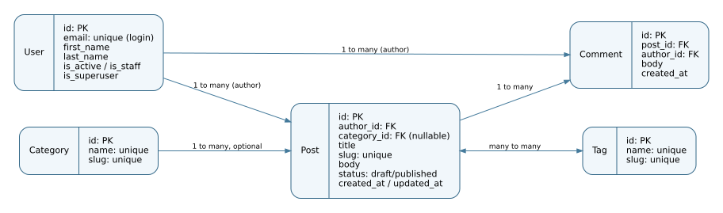

# Blog API — Homeworks 1 + 2

Django REST API with JWT login, a custom email-based user model, a repeatable
Faker seed command and an Unfold-powered administration dashboard.

## ERD



`User` has many `Post` and `Comment`; `Category` has optional one-to-many with
`Post`; `Post` has many `Comment` and many-to-many with `Tag`.

## Getting started

Requires **Python 3.12+**. Work in the repository root.

```bash
python -m venv .venv
# Windows PowerShell: .venv\Scripts\Activate.ps1
# macOS/Linux: source .venv/bin/activate
python -m pip install -r requirements/dev.txt
# Windows PowerShell: Copy-Item settings/.env.example settings/.env
# macOS/Linux: cp settings/.env.example settings/.env
python manage.py migrate
python manage.py seed
python manage.py createsuperuser
python manage.py runserver
```

Open **http://127.0.0.1:8000/admin/** and log in with the superuser you created.
Local settings are SQLite (`BLOG_ENV_ID=local`). Production settings use PostgreSQL
(`BLOG_ENV_ID=prod`). Edit `settings/.env` and replace all sample secrets before
deployment. The `.env` file is ignored by Git; only `.env.example` is committed.

## Seed command (Homework 2 Part 1)

The seed command generates users, categories, tags, posts and comments, with
unique emails/slugs, hashed passwords, and approximately 70% published posts.

```bash
python manage.py seed
python manage.py seed --users 50 --posts 300 --comments 1500
python manage.py seed --clear
python manage.py seed --users 0 --posts 0 --comments 0
python manage.py seed --help
```

| Argument | Default | Explanation |
|---|---:|---|
| `--users` | 20 | Number of new users |
| `--posts` | 100 | Number of new posts |
| `--comments` | 500 | Number of new comments |
| `--clear` | off | Delete existing content and non-superuser accounts |

**Demo user password:** `DemoPassword2026!`. It is for local test data **only**.
Each new user receives the same hash from a single call to `make_password`.
Users, posts and comments use `bulk_create`; the many-to-many tag association
is applied after post IDs become available. Repeat runs preserve existing data;
`--clear` preserves superusers. Negative counts and impossible combinations raise
`CommandError`.

## Admin interface (Homework 2 Part 2)

The Unfold theme includes:

- Custom teal accent, blog branding, environment badge, site dropdown and
  grouped sidebar, with user/access pages hidden from non-superusers.
- Search with **Ctrl+K** or **Cmd+K** over configured admin models, with a
  draft-count badge on Posts and All / Published / Drafts changelist tabs.
- Searchable Category and Tag tables with computed post counts; expandable
  category rows and automatic slugs.
- Comment date-range and autocomplete filters and efficient foreign-key loading.
- Users with header/initials, colored active/staff badges, tabbed edit form,
  password change, and bulk Activate / Deactivate actions.
- Posts with filters, colored status, tag dropdown, sortable comment counts,
  expandable comment rows, autocomplete fields, WYSIWYG editor, tabs,
  paginated comment inline, and publish/unpublish actions.
- Dashboard with four KPI cards, posts-by-category bar chart, top five authors
  table, and published/draft progress bars.

Before submission, **capture four actual screenshots** using instructions in
[docs/screenshots/README.md](docs/screenshots/README.md). They are not included as
pretend images because they need the running Django application.

**GitHub repository link:** set `BLOG_GITHUB_URL` in `settings/.env` to your real
public `blog-api` repository before showing the admin.

## REST API (Homework 1)

| Method | URL | Description |
|---|---|---|
| POST | `/api/auth/register/` | Create account |
| POST | `/api/auth/token/` | JWT login with email/password |
| POST | `/api/auth/token/refresh/` | Refresh access token |
| GET | `/api/auth/me/` | Current user profile |
| GET/POST | `/api/posts/` | List published/own posts; create |
| GET/PATCH/DELETE | `/api/posts/{slug}/` | Read/change/delete posts |
| GET/POST | `/api/comments/` | List/create comments |
| GET/POST | `/api/categories/` and `/api/tags/` | List; staff-only changes |

Example JWT login:

```bash
curl -X POST http://127.0.0.1:8000/api/auth/token/ \
  -H 'Content-Type: application/json' \
  -d '{"email":"student@example.com","password":"your-password"}'
```

Use `Authorization: Bearer <access-token>` for protected routes.

## Quality gates

```bash
python manage.py check
python manage.py makemigrations --check --dry-run
python manage.py test
python -m ruff check .
```

The initial migrations for `auths.User` and all blog models are committed.
No new schema migration is needed for Homework 2.

## Required Git workflow

Create the **public GitHub repository** `blog-api` yourself (your GitHub
credentials are not available to this project). Keep both homework branches:

1. Implement HW1 on `hw1`; merge it into `main` but don't delete the branch.
2. Implement HW2 on `hw2` created from `main`; merge it into `main` but don't
   delete `hw2`.

A ready-made local Git history is available in the separately provided Git
bundle, in addition to zip archives for each homework.
